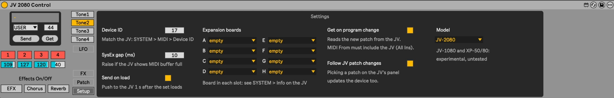
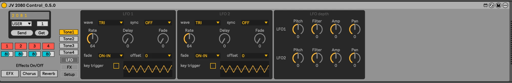
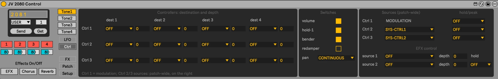
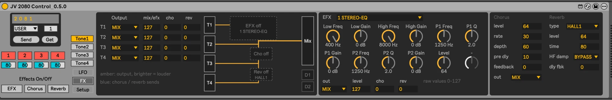
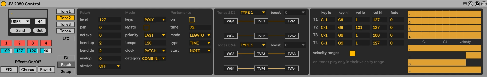

# JV-2080 Control

A Max for Live device that edits a Roland JV-2080 from Ableton Live over MIDI SysEx.
The JV-1080 and XP-50/80 are supported experimentally (Setup → Model).

It edits **every patch parameter** of the JV-2080, reads the JV's current patch back (**Get**), writes the device's
patch to it (**Send**), and follows edits made on the JV's own panel live.

- **Tone view**: per tone Wave, Pitch, Filter and Amplifier (envelopes, keyfollow, velocity). Use the **Tone1–4**
  tabs to choose the tone.
- **Program block** (top left): the patch name (click to rename), bank/program select, **Send** (device → JV) and
  **Get** (JV → device). Below it the tone switches and levels, and Effects On/Off.
- **Pages** (buttons below the Tone tabs):
  - **LFO** and **Ctrl**, per tone: the [LFO page](#lfo-page) and the [controller page](#ctrl-page).
  - **FX**, **Patch** and **Setup**, patch-wide: [effects with routing](#fx-page), [patch settings, structure and
    key/velocity zones](#patch-page), and the [Setup page](#setup-page).

Download it from [maxforlive.com](https://maxforlive.com/library/device/7406/jv-2080-control) or from this repo's Releases page.

## Requirements

- Ableton Live 12 with **Max 9** or newer (Max for Live). Since 0.1.3 the device is saved with Max 9; Live 11 / Max 8
  aren't supported. Use [v0.1.2](https://github.com/tgoelles/jv2080-max-for-live/releases/tag/v0.1.2) for those.
- A Roland JV-2080 connected by MIDI in and out. **JV-1080** and **XP-50/80** work experimentally: choose them on the
  **Setup** page under *Model*. Their sound parameters are identical to the JV-2080's, but they haven't been tested on
  real hardware yet. Reports welcome in [#9](https://github.com/tgoelles/jv2080-max-for-live/issues/9).

## MIDI setup

The device talks to the JV in **both directions**. It sends your edits, and it reads the JV's patch back (**Get**). Both
directions must be wired, or **Get** silently does nothing.

**Cables:** interface MIDI OUT → JV **MIDI IN**, and JV **MIDI OUT** → interface MIDI IN.

**Live → Settings → Link, Tempo & MIDI:** for your MIDI interface, turn **Track** on for both the **input** and the
**output** port.

**The track with the device:**

| Setting | Value |
|---|---|
| MIDI From | **All Ins**, or your interface's port, e.g. *UltraLite mk3 Hybrid (MIDI Port)* |
| Channel (below MIDI From) | **All Channels** |
| Monitor | **In** |
| MIDI To | your interface's port, the one going to the JV |

> **Common mistake:** setting **MIDI From** to *another Live track* (e.g. a track named "JV 2080 MIDI") instead of the
> hardware port. Editing still works, but nothing from the JV reaches the device, so **Get** never loads anything.
> MIDI From must be the hardware port or All Ins. All Ins also keeps your keyboard working on this track.

> **Avoid MIDI loops:** only the JV 2080 Control track should both **receive from** and **send to** the JV. Any other
> track with MIDI From = the JV's port (or All Ins), Monitor In **and** MIDI To = the JV's port echoes everything the JV
> sends straight back to it. The JV then writes its own patch data into the edit buffer and shows the patch as edited
> (**\***), and every read-back doubles the traffic.

To check the wiring, use the [JV SysEx Monitor](diagnostics/README.md). It shows whether data from the JV arrives.

## Setup

1. Put the device on the MIDI track set up as above.
2. Put the JV-2080 in **Patch** mode. If you changed the JV's Device ID (SYSTEM → MIDI, default 17), click **Setup**
   (below the Tone tabs) and set **Device ID** to the same number.
3. Click **Get** (top left, under the patch name) to load the JV's current patch into the device, including its name. After a program change
   this happens automatically. You can turn that off on the **Setup** page. To have the device follow when you pick
   patches on the **JV's own panel**, keep **Setup → Follow JV patch changes** on (default). Edits made on the JV's
   panel, such as turning Cutoff, also show up in the device live.
4. When the set loads, the device sends its saved settings to the JV, so the saved set always wins on load. To send
   them again, click **Send**, next to Get. You can turn off sending on load on the **Setup** page.
5. To **rename** the patch, click the name above the bank menu, type (up to 12 characters) and press Return. The new
   name goes to the JV right away and is saved with the set. Send and the on-load push never change the JV's patch
   name: only typing a name does.

> **The "\*" on the JV's display** means the JV's edit buffer has received changes since the patch was selected. The
> JV sets it on *any* write, even when the values are the same, so Send, Send on load, or moving any control in the
> device shows it, also right after a Get. It doesn't mean something changed: the Max console reports how many bytes
> a Send actually changes ("0 of 452 bytes differ"). The edits only live in the JV's edit buffer: to keep them in the
> JV itself, save the patch with **Write** on the JV, or keep them in your Live set.

### Setup page

Click **Setup** below the Tone tabs to open it, and click a Tone tab to go back. You usually set these once.

| Setting | What it does |
|---|---|
| **Device ID** | Must match the JV: SYSTEM → MIDI → Device ID (17–32, default 17). |
| **SysEx gap (ms)** | Time between messages to the JV (default 10). Raise it if the JV shows "MIDI buffer full". |
| **Send on load** | Sends the device's settings to the JV 1 s after the set loads. |
| **Expansion boards A–H** | The SR-JV80 board in each slot (see SYSTEM → Info on the JV). Adds its waves to the Wave group menu and its patches to the bank menu. See [Expansion boards](#expansion-boards). |
| **Get on program change** | Loads the new patch from the JV after a program change. Needs MIDI From to include the JV. |
| **Follow JV patch changes** | Picking a patch on the JV's panel updates the device too. |
| **Model** | JV-2080, JV-1080 or XP-50/80. Sets the bank list and the patch size for Get. JV-1080 and XP are experimental. |

### LFO page

Click **LFO** (below the Tone tabs) to swap the selected tone's sections for its two LFOs, and click it again to go
back. The Tone tabs keep working on the LFO page.

- **LFO 1 / LFO 2**: wave, sync, rate, delay, fade time, fade mode, offset and key trigger. A small preview draws the
  LFO's shape from key on, with delay, fade and offset; for the OFF fade modes the dashed line marks key off. It's an
  illustration: the JV doesn't document rate and times in seconds.
- **LFO depth**: how much each LFO moves the tone's pitch, filter, amp level and pan (−63 … +63, 0 = off).

All of them are automatable (`T<n> LFO1 Rate`, `T<n> Pitch LFO1 Depth`, …) and are read back by **Get**.

### Ctrl page

Click **Ctrl** (below LFO) for how MIDI controllers change the selected tone, like the JV's controller matrix:

- **Controllers**: for each of the three patch controllers, four destinations with a depth (−63…+63) each: pitch,
  cutoff, resonance, level, pan, mix, chorus and reverb send, the LFO depths and the LFO rates. Controller 1 is the
  modulation wheel; the sources of Controllers 2 and 3 are set on the right.
- **Switches**: whether the tone reacts to volume, hold-1 (sustain), the pitch bender and redamper, and how it follows
  pan (OFF, CONTINUOUS, KEY-ON).
- **Patch-wide** (right column, the same for all tones): the sources of Controllers 2 and 3 (e.g. AFTERTOUCH, FOOT,
  VELOCITY), Hold/Peak for each controller, and the EFX control: two sources with depths that move the EFX's realtime
  parameters (the ones marked # in the manual).

### FX page

Click **FX** (below the Tone tabs) for the patch's effects, as on the JV's PATCH → Effects pages:

- **Routing**: where each tone goes (**Output** MIX / EFX / DIR1 / DIR2) and its mix/EFX, chorus and reverb send
  levels. The graphic next to it is redrawn from these settings: amber lines are outputs, blue lines are chorus and
  reverb sends, brighter means louder, and blocks nothing reaches are greyed out. A unit switched off with the
  *Effects On/Off* buttons is drawn dashed, like on the JV. Those buttons also follow the JV's own EFX / CHORUS /
  REVERB buttons.
- **EFX**: the type (40 types) and its 12 parameters. The dials are labelled for the selected type; unused slots are
  greyed out. Below them are the EFX output, level, and chorus and reverb sends.
- **Chorus** and **Reverb**: level, rate, depth, pre-delay, feedback and output; reverb type, level, time, HF damp
  and delay feedback.

Under each EFX dial is the value as the JV shows it: dB, Hz, cent, %, degrees, pan, balance, or the type's choices.
Each dial's full travel covers the parameter's range. Rates, pre delay and delay times show the JV's raw number in
brackets, e.g. "(80)", until their value tables are measured
([#51](https://github.com/tgoelles/jv2080-max-for-live/issues/51)); the JV's display shows them in Hz or ms.
The order and ranges of all 40 EFX types were measured on a JV-2080, since the manual's parameter lists aren't in the
order the JV uses. The **EFX / Chorus / Reverb** buttons under *Effects
On/Off* still switch the whole unit's effects on and off.

### Patch page

Click **Patch** (below the Tone tabs) for the settings of the whole patch:

- **Patch / Mode / Portamento**: level, pan, octave shift, bend range up/down, analog feel, stretch tune; key assign
  POLY/SOLO, solo legato, voice priority, patch tempo (shows "---" when the clock source is SYSTEM, like the JV),
  clock source and category; portamento on/off, time, mode,
  type and start.
- **Structure**: how Tones 1&2 and 3&4 are combined (Types 1–10, with booster and ring modulator), with a diagram
  like the JV's Struct page. The **boost** menu only matters for Types 3 and 4 and is greyed out otherwise.
- **Key / velocity zones**: per tone the keyboard range (C-1 … G9), velocity range and velocity cross fade, for
  splits and layers. The graphic shows each tone's key range as a strip over the keyboard, and its velocity range
  as a vertical bar below (soft at the bottom, hard at the top), like Live's velocity lane. **Drag** an end of a
  strip or bar to change that range directly.
  Velocity ranges only apply when **velocity ranges** is on.

## Global controls (cutoff, resonance, attack, release)

The JV-2080 has built-in controllers that shift a parameter on **all four tones at once**, relative to the patch
(manual p.185). They're plain MIDI CCs, so you don't need this device for them. Use them from Live directly:

| CC | Effect |
|---|---|
| 74 | Filter cutoff, all tones |
| 71 | Resonance, all tones |
| 73 | Envelope attack (Time 1 of filter and amp envelopes) |
| 72 | Envelope decay/release (Times 2–4 of filter and amp envelopes) |
| 80 / 81 / 82 / 83 | Amp envelope levels of Tone 1 / 2 / 3 / 4 |

Value 64 means "as stored in the patch". Lower or higher values shift down or up.

- **Knobs:** add Live's **CC Control** device (Max for Live, MIDI tools, Live Suite) next to JV 2080 Control on the same
  track, and set its knobs to the CCs above. They're automatable and mappable to a controller.
- **Automation:** in a MIDI clip, draw an envelope for *MIDI Ctrl → 74* (etc.).
- The JV must receive control changes (*Rx Control Change* on) on the channel you send. These offsets aren't stored in the
  patch, and **Get** doesn't see them.

## Expansion boards

Open **Setup** and pick the board installed in each slot (A–H). SYSTEM → Info on the JV shows them. The Wave group menu then
lists INT-A, INT-B and your boards with their slot, e.g. **XP-A Techno**. The setup is saved with the Live set.

The **bank menu** in the program block works the same way: it adds **XP-A1** (patches 1–128) and **XP-A2**
(129–255) for every slot with a board, so you can select the board's own patches.

Internally a wave group is stored by SR-JV80 board number, the same way the JV stores it in a patch. So automation and saved
sets keep working if you move a board to another slot. A patch that uses a board you haven't set up shows as
"SR-nn (not set up)".

| | | | |
|---|---|---|---|
| SR-01 Pop | SR-06 Dance | SR-11 Techno | SR-16 Orchestral II |
| SR-02 Orchestral | SR-07 Super Sound Set | SR-12 Hip Hop | SR-17 Country |
| SR-03 Piano | SR-08 Keyboards of the 60s & 70s | SR-13 Vocal | SR-18 Latin |
| SR-04 Vintage Synth | SR-09 Session | SR-14 Asia | SR-19 House |
| SR-05 World | SR-10 Bass & Drum | SR-15 Special FX | |

## Wave names

Each tone's Wave section shows the selected wave's **name** under the Wave dial, e.g. *TB Dst Saw*, when the device
knows the names for that wave group. The names for the internal waves (INT-A / INT-B) and SR-JV80 boards 01–11 are included. They're generated from the boards' documentation with:

    python3 -I tools/import_wave_names.py

The script downloads the SR-JV80 board documents from planet-groove.com and writes `device/jv2080_names.js`. It finds wave
lists for boards **01–11**; the documents for 12–19 only list patches. If the site refuses a download (it sometimes
answers 403), run the script again. Internal waves
(INT-A / INT-B) come from `docs/int_waves.txt`; `--keep` merges them into the existing file without downloading again:

    python3 -I tools/import_wave_names.py --internal docs/int_waves.txt --keep

For wave groups without names, the device shows only the wave number.

## Development

The source files are in `device/`: an unfrozen `.amxd`, its `.maxpat` abstractions (one per section and page) and its
`.js` scripts. `CLAUDE.md` describes how they fit together. Open the
`.amxd` in Live, then edit it in Max.

**One-time setup:** in Max, open **Options → File Preferences** and add this repo's `device` folder to the search path.
Without it, a copy of the device, which Live sometimes opens when you click Edit, fails with
`bpatcher: error loading patcher JV_*.maxpat`, and freezing can't bundle the abstractions and scripts. To see readable diffs of `.amxd` files, run:

    git config diff.amxd.textconv "python3 -I tools/amxd.py textconv"

Run all offline checks (patch structure, generated bindings, tests) with `tools/check.sh`. It needs Python 3 and Node.

The [JV-2080 Owner's Manual](https://static.roland.com/assets/media/pdf/JV-2080_OM.pdf) is from Roland. Its MIDI
implementation starts on p.184.

## License

[CC BY-NC 4.0](LICENSE) (Creative Commons Attribution-NonCommercial): free to use, share and modify, but not for commercial purposes. Same license as on maxforlive.com.
