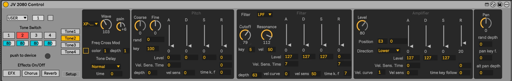

# JV-2080 Control

A Max for Live device that edits a Roland JV-2080 from Ableton Live over MIDI SysEx.
The JV-1080 and XP-50/80 support is planned.

The device has per-tone sections for Wave, Pitch, Filter and Amplifier (envelopes, keyfollow and
velocity), plus Tone switches and levels, Effects on/off, and bank/program select. Use the Tone1–4 tabs to
choose which tone you're editing.

Download it from [maxforlive.com](https://maxforlive.com/library/device/7406/jv-2080-control) or from this repo's Releases page.

## Setup

1. Put the device on a MIDI track and route that track's MIDI output to the port the JV-2080 is connected to.
2. Put the JV-2080 in **Patch** mode and set its Device ID to 17 (the default).
3. Click the **push to device** button (left column, above Effects On/Off) to send every setting shown in the device.

## Development

The source files are in `device/`: an unfrozen `.amxd` plus its `.maxpat` abstractions. Open the `.amxd` in Live,
then edit it in Max. To see readable diffs of `.amxd` files, run:

    git config diff.amxd.textconv "python3 -I tools/amxd.py textconv"

The [JV-2080 Owner's Manual](https://static.roland.com/assets/media/pdf/JV-2080_OM.pdf) is from Roland. Its MIDI
implementation starts on p.184.

## License

[CC BY 4.0](LICENSE) (Creative Commons Attribution), the same license as on maxforlive.com.
